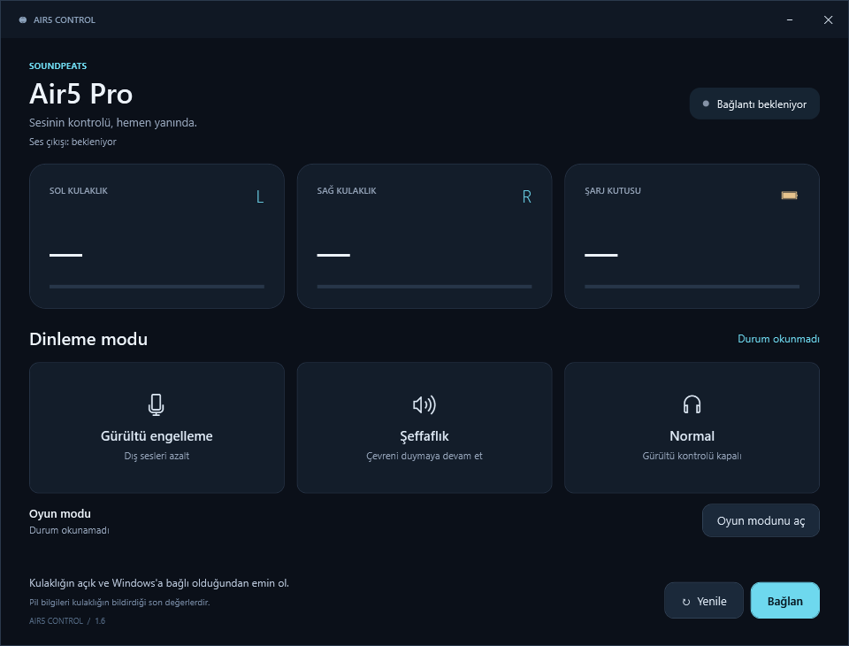

# Air5 Control

**SOUNDPEATS Air5 Pro için Windows sistem tepsisi uygulaması.**

[English](README.en.md) · [İndir](https://github.com/ardacob/air5-control/releases/latest) · [Sorun giderme](docs/TROUBLESHOOTING.md) · [Protokol](docs/PROTOCOL.md)

ANC, şeffaflık, Normal ve oyun modu kontrolü; kulaklık ve kutu pili; Windows ile otomatik başlatma. EQ ayarlarına komut göndermez. Bağımsız bir projedir; SOUNDPEATS ile bağlantılı değildir.

## İndir ve çalıştır

1. [Releases](https://github.com/ardacob/air5-control/releases/latest) bölümündeki taşınabilir ZIP paketini indir.
2. ZIP'i uygulamayı tutacağın kalıcı klasöre çıkart.
3. Kulaklığı Windows Bluetooth ayarlarında eşleştir.
4. **Air5-Control.exe** dosyasını çalıştır. Yönetici yetkisi gerekmez.

Uygulama doğrudan sistem tepsisinde açılır. Simge gizliyse saatin yanındaki gizli simgeler bölümüne bak. İndirme paketindeki EXE kod imzalı değildir.

## Özellikler

| Kontrol | Davranış |
| --- | --- |
| ANC / Şeffaflık / Normal | Mod değişikliğini cihazdan tekrar sorgulayarak doğrular |
| Oyun modu | Aç/kapat; geçerli durum yanıtı yoksa düğme etkinleşmez |
| Pil | Sol, sağ ve cihaz bildiriyorsa şarj kutusu |
| Sistem tepsisi | Modlar, oyun modu, pil, yenileme, yeniden bağlantı |
| Otomatik başlatma | Geçerli kullanıcı oturumuyla açılır; menüden kapatılabilir |
| Yeniden bağlantı | Önce Windows ses çıkışını bekler, sonra BLE kontrol kanalını açar |
| Tanılama | Yerel connection.log ve air5.log dosyaları |

Pil ve mod bilgileri yaklaşık 30 saniyede bir yenilenir. Kutu pili canlı, bağımsız bir kutu ölçümü değil; kulaklığın bildirdiği son değerdir. Bilgi alınamazsa yüzde yerine tire gösterilir.

## Kullanım

- Simgeye **çift tık**: ana pencere.
- Simgeye **sağ tık**: hızlı kontroller ve pil bilgileri.
- Penceredeki **X / küçült**: sistem tepsisine gizle.
- **Windows ile başlat**: otomatik başlatmayı aç/kapat.
- **Çıkış**: uygulamayı tamamen kapat.

İlk normal çalıştırmada otomatik başlatma varsayılan olarak etkinleşir; daha sonra kapatırsan tercihin korunur. EXE'yi taşırsan yeni konumdan bir kez çalıştır. Uygulamayı silmeden önce otomatik başlatmayı kapat.

## Önce ses, sonra kontrol

BLE kontrol bağlantısı, Windows ses bağlantısı ile aynı şey değildir. Erken BLE bağlantısı cihazdaki ses bağlantısının geri gelmesini etkileyebildiği için v1.6 şu sırayı kullanır:

1. Windows'un Air5 Pro ses çıkışını etkin göstermesini bekle.
2. Aynı çıkışın en az 8 saniye kararlı görünmesini bekle.
3. BLE kanalını aç ve pil/mod bilgilerini sorgula.
4. Ses çıkışı kaybolursa BLE kaynaklarını bırak; tekrar ses bağlantısını bekle.

Kontrol 3 saniyede bir yapılır; başarısız işlemlerden sonra en az 15 saniye beklenir. Elle **Bağlan** da ses beklemesini atlamaz. Uygulama Windows Bluetooth radyosunu, eşleştirmeyi veya varsayılan ses aygıtını değiştirmez.

## Uyumluluk ve sınırlar

- **Windows**, .NET Framework 4.8 ve Windows Bluetooth desteği gerekir.
- **SOUNDPEATS Air5 Pro** ile, cihaz adı SOUNDPEATS Air5 Pro olacak şekilde geliştirilmiştir.
- Air5, Air5 Lite, Air5 Pro+ ve diğer modeller destekleniyor kabul edilmez.
- İki aynı adlı kulaklık bulunursa bağlantı yapılmaz.
- EQ, adaptif EQ, ana kazanç veya firmware yazılmaz. Profil içeriği okunup yedeklenmez.
- Normal modda basın ANC'ye göre azalması kulaklığın dokunmatik kontrolünde de gözlenmiştir; uygulama bunu EQ ile telafi etmez.
- Oyun modu için belirli bir gecikme değeri vaat edilmez. Bu projede gecikme ölçümü yapılmadı.
- Etkin ses çıkışı görülmesi, varsayılan çıkışın seçildiğini veya gerçekten ses duyulduğunu tek başına kanıtlamaz.

## Kaynaktan derle

Ek NuGet bağımlılığı veya Visual Studio projesi yoktur. Windows PowerShell 5.1 kullan:

~~~powershell
powershell.exe -NoProfile -ExecutionPolicy Bypass -File .\Derle.ps1
powershell.exe -NoProfile -ExecutionPolicy Bypass -File .\scripts\Test.ps1
~~~

Derleme .NET Framework CodeDOM, WPF/Windows Forms ve Windows WinMetadata referanslarını kullanır. Sonuç depo kökünde Air5-Control.exe olur. Kaynak klasörünü koru; XAML, simge ve manifest derlemede gömülür. Çalışma zamanında kaynak dosyaları gerekmez.

## Doğrulama

v1.6; Air5 Pro, firmware **S1_20250410_V2.2** ile kullanıcı tarafından doğrulandı: pil, ANC/şeffaflık/Normal, tepsi, kutuya koyup çıkarma sonrası otomatik ses ve kontrol bağlantısı, video sesi ve oyun modu.

Otomatik testler ses bekleme sırasını, kopma sonrası sıfırlamayı, paket sınırlarını, durum ayrıştırmayı ve tepsi davranışlarını kapsar. Donanım testi yerine geçmez. Ayrıntılar [mimari notlarında](docs/ARCHITECTURE.md).

## Gizlilik ve kaldırma

Uygulamada ağ isteği veya telemetri yoktur. Windows'un Bluetooth iletişimi kullanılır. Yerel loglar pil/mod durumlarını ve hata ayrıntılarını içerebilir; paylaşmadan önce incele.

Otomatik başlatma kayıtları yalnızca mevcut kullanıcıdadır:

- HKCU\Software\Microsoft\Windows\CurrentVersion\Run → Air5Control
- HKCU\Software\Air5Control → StartupEnabled

Otomatik başlatmayı menüden kapat, **Çıkış** yap ve uygulama klasörünü sil. Tercih kaydı küçük bir kullanıcı ayarı olarak kalabilir.

## Katkı ve lisans

Hata bildirirken sürümü, Windows sürümünü, firmware'i, yeniden üretme adımlarını ve gerekirse kişisel bilgilerden arındırılmış log bölümünü ekle. APK, kişisel cihaz kimlikleri veya tam sistem dökümleri gönderme.

[MIT License](LICENSE). Protokol gözlemleri [docs/PROTOCOL.md](docs/PROTOCOL.md) içinde açıklanmıştır. SOUNDPEATS ve ürün adları ilgili sahiplerine aittir.
